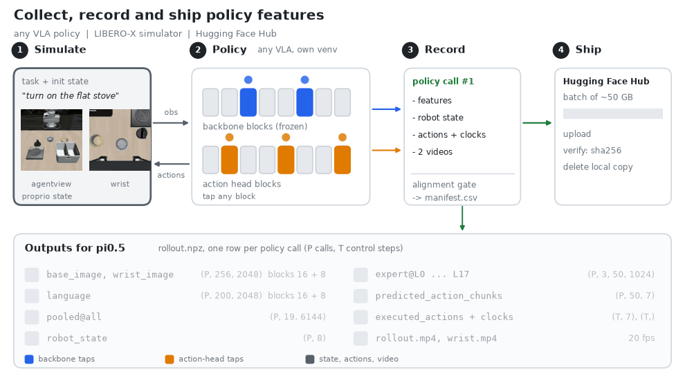

# vla-feature-collection

Roll out a VLA policy on **[LIBERO-X](https://github.com/meituan/LIBERO-X)** and cache its internal
hidden states ("embeddings") for every policy call, together with the robot state, actions, clocks,
success and videos. Two policies are wired up: **GR00T-N1.7** (frozen VLM backbone, layer 16) and
**pi0.5** through LeRobot with a LoRA adapter (backbone and action-expert blocks, full or pooled tokens).
Finished episodes can be shipped to a Hugging Face dataset and deleted locally.

<p align="center"></p>

*The pipeline is policy-agnostic: the simulator sends observations to any VLA over a websocket, hooks inside the
policy capture hidden states, the recorder writes them with actions, robot state, clocks and videos, and finished
batches are uploaded, verified and deleted locally. The outputs panel shows what the pi0.5 policy produces
(`scripts/pi05-libero-x/DATASET_CARD.md`); the animation is rendered by `docs/make_pipeline_gif.py`.*

Policy and simulator run in separate venvs and talk over an openpi-style msgpack websocket (GR00T shown;
the pi0.5 section below uses the same split):

```
top-level .venv (py3.11)                     submodules/Isaac-GR00T/.venv (py3.10)
  scripts/groot-libero-x/collect.py   ──ws──►  scripts/groot-libero-x/server/serve_groot_ws.py
  LIBERO-X env, rollout loop, writer           Gr00tPolicy + layer-16 feature capture
```

## Setup

Accept the [Cosmos-Reason2-2B](https://huggingface.co/nvidia/Cosmos-Reason2-2B) licence (the
GR00T backbone) and log in with `hf auth login`, then:

```bash
git clone --recurse-submodules <this repo>   # Isaac-GR00T @ n1.7-release, LIBERO-X
scripts/groot-libero-x/setup.sh              # both venvs + checkpoint (large: torch cu128, flash-attn)
```

Checkpoint: [`rohansiva/gr00t-libero-x-level123`](https://huggingface.co/rohansiva/gr00t-libero-x-level123)
(GR00T-N1.7 fine-tuned on LIBERO-X LEVEL1-3).

## Collect

```bash
# one command: starts the server if needed, collects, stops the server it started
WITH_FEATURES=1 scripts/groot-libero-x/collect.sh --level LEVEL1 --n-rollouts 10

# all three levels, then a per-level success summary
WITH_FEATURES=1 scripts/groot-libero-x/collect_all.sh

# manual: server in one terminal, client in another
scripts/groot-libero-x/serve.sh checkpoints/gr00t-libero-x-level123 --with-features
MUJOCO_GL=egl uv run python scripts/groot-libero-x/collect.py --level LEVEL1 --with-features
```

Tasks come from `scripts/groot-libero-x/tasks/LEVEL{1,2,3}.txt` (72 / 73 / 73 BDDL files;
`selection.csv` has the per-task metadata). Pass `--tasks-file` for another list.
Protocol follows LIBERO-X's `eval_template.py`: `max_steps=1200`, fresh env per episode,
init-state reset, native image convention. `collect.py` resumes: finished episodes are skipped.

## Output

`outputs/groot-libero-x/collect/<LEVEL>/<NN>_<task>/ep<NNN>/` with `rollout.json`,
`rollout.npz`, `rollout.mp4`, `wrist.mp4`, plus a `manifest.csv` (rewritten after every episode).
Each episode is reloaded and passed through an alignment gate before it enters the manifest.

`rollout.npz` with `--with-features` (P = number of policy calls, fp16), keyed row-for-row to `policy_step`:

| key | shape | |
|---|---|---|
| `base_image`, `wrist_image` | `(P, 64, 2048)` | layer-16 hidden states of the image tokens (2x2-merged patches) |
| `language`, `language_mask` | `(P, 200, 2048)`, `(P, 200)` | instruction tokens, zero-padded, real-vs-pad mask |
| `language_len` | `(P,)` | real instruction token count |
| `state_features` | `(P, 1536)` | the action head's embedded proprio vector |
| `executed_actions`, `predicted_action_chunks` | `(T, 7)`, `(P, 16, 7)` | what the sim ran / what the policy predicted |
| `control_step`, `sim_step`, `policy_step`, `chunk_index`, `video_frame_id` | `(T,)` | the aligned clocks |

Features are the **raw layer-16 residual stream** of the Cosmos-Reason2-2B (Qwen3-VL) backbone,
taken before the action head's `vlln` + VL self-attention.
`--replan-steps` (default 25) is how many actions of each 16-step chunk run before re-querying.

## Tests

Pure unit tests (no simulator, GPU or network):

```bash
cd scripts/groot-libero-x && python -m unittest discover -s tests
```

## pi0.5 (LeRobot) with the LoRA adapter

Same collector, different policy. The adapter is
[`podolinsky/pi05-libero-x-level123-lora`](https://huggingface.co/podolinsky/pi05-libero-x-level123-lora)
(LoRA on the action expert of `lerobot/pi05_libero`, trained on the 218 LIBERO-X Level 1-3 tasks;
a one-epoch checkpoint, so expect a low success rate). The policy runs in its own venv:

```bash
(cd scripts/pi05-libero-x && uv sync)            # LeRobot 0.7.0, Python 3.12
scripts/pi05-libero-x/collect.sh --level LEVEL1 --n-rollouts 10      # server + collector in one go
LAYERS=16,17,final POOL=2 scripts/pi05-libero-x/collect.sh --level LEVEL1   # several layers, 64 tokens/camera
```

Or by hand: `scripts/pi05-libero-x/.venv/bin/python scripts/pi05-libero-x/serve_pi05.py --with-features --layers 16`
and `MUJOCO_GL=egl uv run python scripts/groot-libero-x/collect.py --policy pi05 --with-features`.
`eval_quick.py` is a small success-rate check against the same server. Outputs go to
`outputs/pi05-libero-x/collect/` with the same layout as the GR00T runs. The adapter repo lacks the
`tokenizer/` artifact its preprocessor config points at; the server fetches the stock PaliGemma
tokenizer into `checkpoints/pi05-libero-x-level123-lora/` on first start.

**What is saved.** Hidden states of the PaliGemma Gemma-2B backbone (18 blocks, width 2048) from the
prefix pass, split by token type like the GR00T features: `base_image`, `wrist_image`
`(256, 2048)` each (`256 / POOL**2` with `POOL`), `language` `(200, 2048)` + `language_mask`
(padded slots zeroed; the discretised robot state is part of this text), fp16, one row per policy
call. There is no `state_features`. `LAYERS` lists 0-based block outputs; the first is the primary
(unsuffixed keys), the rest are saved as `base_image@L17` etc.

**Action-expert states.** `EXPERT_LAYERS=16` (0-based expert block, 0..17) additionally saves that block's
output at each denoise step as `expert@L16` `(S, 50, 1024)` fp16 (one row per policy call), with
`expert_t@L16` `(S,)` giving the flow time of each step. `EXPERT_STEPS` is `all` (10 steps, default) or
indices (`0` = first, `9` = last). In openpi's convention t=1.0 is pure noise and t=0.1 the last step,
and the update is `x <- x + dt*v` with `dt = -0.1`. Unlike the backbone, every expert block is read by the
action head, and the adapter's LoRA sits inside them, so these states depend on the adapter.

```
prefix = [ image 256 | wrist 256 | empty camera 256 (dropped) | text 200 ]  ->  Gemma-2B blocks b0 ... b17
                                                                            -> final norm -> prefix_out
action expert (Gemma-300M, 18 blocks): block i attends to the cached K/V of backbone block i,
i.e. to the output of backbone block i-1
```

- Blocks **17** and **final** are computed but never read by the action expert (perturbing them changes
  no action). **16** is the last block whose output the action head sees (default).
- Activations grow with depth: block 16 has rms about 120-170 (max about 5k), block 17 about 400-500
  (max about 49k, close to fp16's 65k), `final` about 1.
- The LoRA only touches the action expert, so these backbone features are the same as the base
  model's; the adapter only changes which actions are executed.
- Size on disk, per policy call: backbone layer at 256 tokens/camera about 1.85 MB (`POOL=2`: about 0.6 MB);
  one expert block over all 10 steps about 0.8 MB (2 steps: about 0.16 MB). A 1200-step failure episode
  makes 120 calls.

### Collect and ship to a Hugging Face dataset

`scripts/pi05-libero-x/run_and_ship.py` runs the collection task by task and uploads in batches
(about 50 GB) so the disk never fills up:

```bash
.venv/bin/python scripts/pi05-libero-x/run_and_ship.py --repo-id <user>/<dataset> --visibility public --n-rollouts 5
```

Per policy call it saves the robot state, backbone blocks 16 and 8 as full tokens, mean-pooled per-modality
6144-d vectors of all 19 backbone layers, and all 18 expert blocks at denoise steps 0, 5, 9
(`DATASET_CARD.md` documents every key; it becomes the dataset's README). One full-length episode is about
1 GB. `scripts/groot-libero-x/ship_to_hub.py` does the shipping: commit the episode directories, check every
file on the Hub (size and sha256), and only then delete `rollout.npz` and the videos locally (`rollout.json`,
`manifest.csv` and a `shipped.json` marker stay, so a resumed run skips them). Any mismatch or error stops with
nothing deleted; afterwards the Hub holds the only copy.

## Credits and licence

Code: [MIT](LICENSE). Built on NVIDIA [Isaac-GR00T](https://github.com/NVIDIA/Isaac-GR00T) (Apache-2.0),
Meituan [LIBERO-X](https://github.com/meituan/LIBERO-X) (MIT code; CC BY 4.0 dataset),
Physical Intelligence [openpi](https://github.com/Physical-Intelligence/openpi) (Apache-2.0;
`server/msgpack_numpy.py` is vendored from `openpi-client`) and Hugging Face
[LeRobot](https://github.com/huggingface/lerobot) (Apache-2.0). Third-party notices are in
[THIRD_PARTY_NOTICES.md](THIRD_PARTY_NOTICES.md). Model weights keep their own terms: the π0.5 base and
adapter fall under the Gemma terms of use, and the GR00T backbone (Cosmos-Reason2-2B) under NVIDIA's licence.
